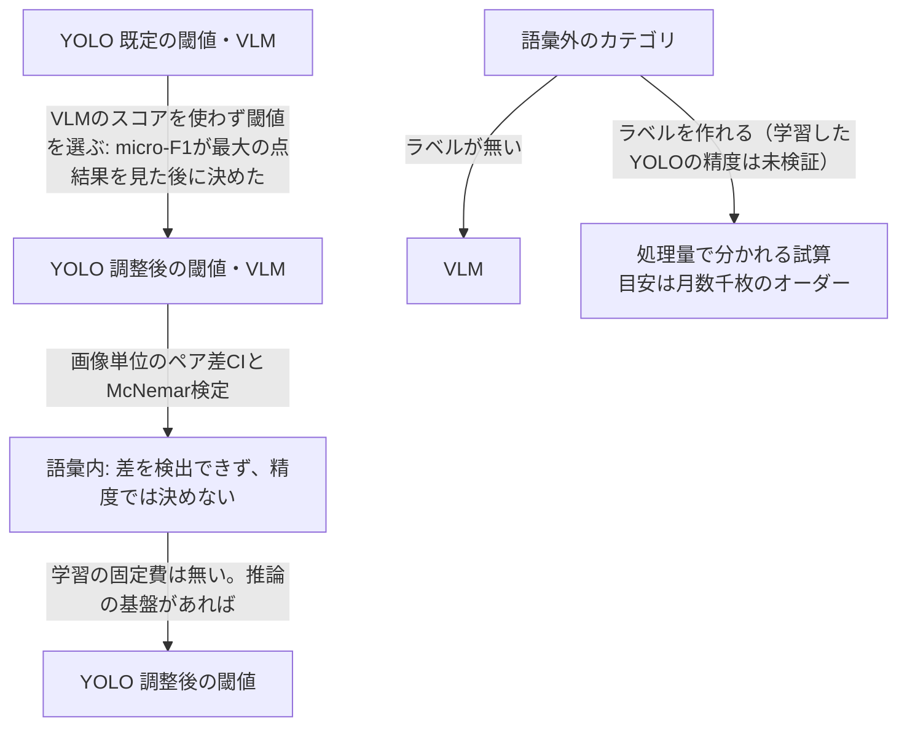
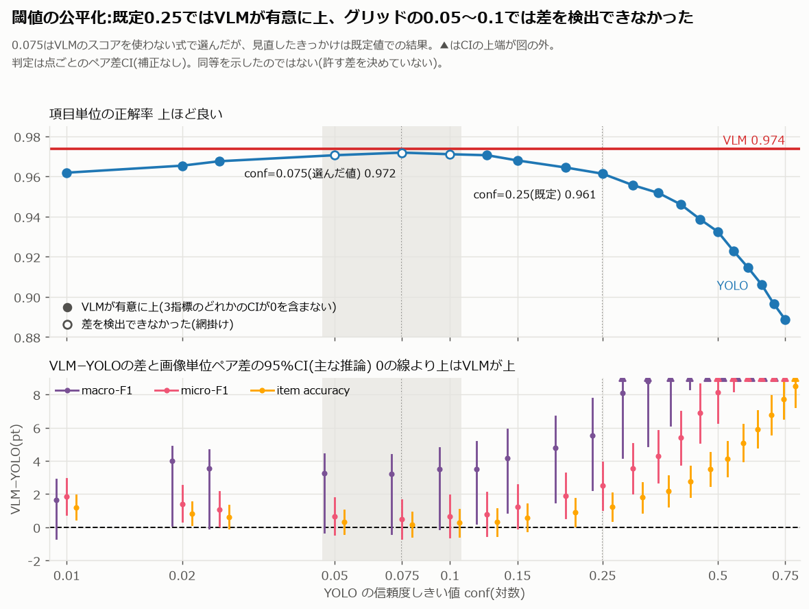
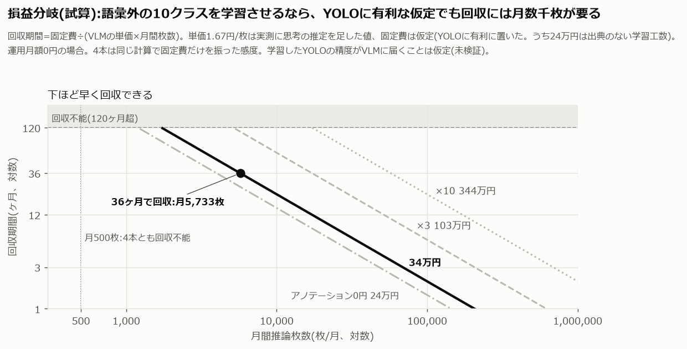

# vlm-vs-yolo ― COCOの有無判定でYOLOの閾値を調整するとVLMとの有意差が消え、選択はコスト・処理量・語彙で決まった

画像に「期待される項目」が写っているかを判定するタスクで、汎用の視覚言語モデル（VLM、`gemini-3.5-flash`）と専用検出器（YOLO、COCO学習済みの`yolo26x`）を、COCO val2017の300枚・2,281項目で比べた。
問いは、既定の設定で出た有意差は実力の差か設定の差か、差が無いならどの条件でどちらを選ぶか、である。

記事: [前編（背景）](https://zenn.dev/yuya0408/articles/yolo-vs-vlm-background) / [後編（検証）](https://zenn.dev/yuya0408/articles/yolo-vs-vlm-evaluation-pitfall)　詳しい分析: [report/REPORT.md](report/REPORT.md)　全部の値: [docs/results.md](docs/results.md)

> YOLOとVLMの優劣を決めるプロジェクトではない。許す差を決めていないので同等は示しておらず、言えるのは「この件数では差を検出できなかった」までである。



---

## 結果サマリー

| 項目 | 値 |
| --- | --- |
| 既定 conf=0.25 | VLM−YOLOの差：macro-F1 +5.5pt [+2.3, +7.8]、McNemar p=0.004。**VLMが有意に上** |
| 調整後 conf=0.075 | 差：macro-F1 +3.2pt [−0.4, +4.4]、micro-F1 +0.5pt [−0.7, +1.6]、McNemar p=0.71。**差を検出できなかった** |
| 差を検出できない閾値の範囲 | グリッド上のconf 0.05〜0.10（画像単位のペア差CIで、3指標とも0を含む）。それ以外ではどれかの指標でVLMが有意に上（点ごと、補正なし） |
| macro-F1の差の内訳 | 3.2ptのうち2.6ptは正例1件の2カテゴリ。正例3件以上に絞ると0.2pt |
| コスト（300枚） | YOLO 0円（API課金が0という意味）、VLM 約501円（思考の費用は30枚の標本からの推定。95%区間 459〜548円） |
| レイテンシ中央値 | YOLO 0.33秒（手元のマシン）、VLM 5.42秒（API経由）。条件が違うので参考の値 |
| 損益分岐（語彙外でラベルを作る場合の試算） | YOLOに有利な仮定で累計約21万枚。回収36か月を許すなら月5,733枚。学習したYOLOの精度は未検証 |
| プロンプト3水準 | ばらつきはmacro-F1で0.46pt。YOLOとの判定は変わらず |
| 語彙外のカテゴリ | 配管のチェックリスト10項目中9項目がCOCOの語彙に無く、YOLOは判定できない（定性デモ） |

**語彙内では精度の差が閾値の設定で出たり消えたりし、選ぶ決め手はコスト・処理量・語彙に移った。**

| 用語 | 意味 |
| --- | --- |
| 有無判定 | 座標は問わず、カテゴリが画像に写っているかだけを判定する。YOLOは閾値以上の検出が1個でもあれば`present` |
| conf | YOLOの信頼度の閾値。既定は0.25 |
| macro-F1／micro-F1 | カテゴリごとのF1の平均（正例1件のカテゴリも同じ重み）／全カテゴリを足してから計算したF1 |
| item accuracy | 正解した項目の割合 |
| strict | VLMの`uncertain`を誤りとして数える集計。指標はすべてこれ |
| 差 [ ] | VLM−YOLOの点差と、画像単位のペア差ブートストラップ95%CI |

---

## 既定の閾値ではVLMが有意に上だったが、閾値を選び直すと差を検出できなくなった

**既定 conf=0.25 のp=0.004は、VLMのスコアを使わずに選んだ conf=0.075 でp=0.71になった。動かしたのはYOLOの閾値だけである。**



塗りの印はVLMが有意に上（3指標のどれかで、画像単位のペア差95%CIが0を含まない。点ごと、多重比較の補正なし）、白抜きは差を検出できなかった点（網掛け）。下段が主な推論のペア差CIである。

操作点はmicro-F1とitem accuracyが最大の閾値で、どちらも0.075だった。差を検出できない範囲はその前後に限られ、0.025ではmicro-F1、0.125・0.15ではmacro-F1のCIが0を含まない。
既定の閾値での差はYOLOの見逃しから来ていて、調整で見逃しは77件から34件に減った（偽陽性は11件から30件に増えた）。
閾値ごとのCIは[詳しい値](docs/results.md#閾値ごとの差)、選び方と却下した案は[ADR-0001](docs/adr/0001-threshold-operating-point.md)にある。

---

## 精度で決められない語彙内では、決め手はコストと処理量になる

**300枚のコストはYOLOが0円、VLMが約501円で、レイテンシの中央値は0.33秒と5.42秒である。語彙外のカテゴリにラベルを作ってYOLOに学習させる場合は、YOLOに有利な仮定でも固定費の回収に月数千枚が要る（試算）。**

| | 300枚のコスト | レイテンシ中央値（p95） | 条件 |
| --- | --- | --- | --- |
| YOLO（conf=0.075） | 0円 | 0.33秒（0.52秒） | API課金が0という意味。手元のマシンで計測 |
| VLM | 約501円（記録は251円） | 5.42秒（7.87秒） | API経由。経路が違うので、同じ条件の比較ではない |

記録した251円は思考（thinking）のトークンを含まない。思考の分は、30枚を思考も記録して呼び直した標本の比（思考÷出力＝1.69、95%区間 1.40〜2.01）から推定した（[導出](docs/results.md#思考の費用の推定)）。閾値は推論後のフィルタなので、調整してもコストとレイテンシは動かない。



線の高さが、その月間枚数での回収期間である。網掛け（120か月超）は回収不能とみなす。

```
YOLOの累計(Tか月) = 固定費 + 運用の月額 × T
VLMの累計(Tか月)  = 1.67円/枚 × 月間枚数 × T          （(記録251円 + 思考の推定250円) ÷ 300枚）
固定費 = 3,000枚 × 5矩形 × 5.8円 × 手戻り1.2 + 40時間 × 6,000円 = 104,400円 + 240,000円 = 344,400円
```

基準の固定費で損益分岐は累計206,392枚、回収36か月に要るのは月5,733枚で、固定費を24万〜344万円に振っても月500枚では回収できない。学習したYOLOがVLMと同じ精度に届くことは確かめていない。
語彙内では学習済みのYOLOをそのまま使えるので学習の固定費はかからず、推論の基盤があればYOLOの方が安い。仮定の置き方は[ADR-0003](docs/adr/0003-breakeven-assumptions.md)、固定費ごとの表は[詳しい値](docs/results.md#損益分岐の全表)にある。

---

## 語彙外のカテゴリは、COCO学習済みのYOLOでは判定できない

**配管のチェックリスト10項目のうち9項目はCOCOの80クラスに無く、YOLOは閾値によらず`present`を返せない。VLMは追加の学習なしで判定と根拠を返す。**

| | 語彙内（COCO） | 語彙外・ラベルを作れる | 語彙外・ラベルなし（配管の5枚） |
| --- | --- | --- | --- |
| YOLO | 閾値の調整で差を検出できなくなる。学習の固定費は無い | 学習すれば判定できる。精度は未検証 | 10項目中9項目を判定できない |
| VLM | 差を検出できない | 追加の学習なしで動く。精度は未検証 | `present`／`absent`／`uncertain`と根拠を返す |
| 選択 | 推論の基盤があればYOLO | 処理量で分かれる（上の試算、仮定つき） | VLM |

正解ラベルが無いので、精度は測っていない。示したのは、動くかどうかだけである。画像ごとの判定は [REPORT 付録](report/REPORT.md#付録-建設ドメインでの適用可能性デモ定性)にある。

---

## プロンプト・カテゴリの絞り込み・閾値の刻みを変えても、結論は変わらなかった

| 確かめ | 結果 | 詳しく |
| --- | --- | --- |
| プロンプト3水準（`concise`・`deliberate`・`calibrated`） | tuneのmicro-F1で選ぶと`concise`のままで、test 180枚でYOLOとの差は検出できない（p=0.42）。ばらつきはmacro-F1で0.46pt | [詳しい値](docs/results.md#プロンプト3水準)・[ADR-0002](docs/adr/0002-prompt-sensitivity-rule.md) |
| macro-F1の差の内訳 | 3.2ptのうち2.6ptはtoaster・toothbrush（正例1件）で、正例3件以上の71カテゴリでは0.2pt。既定の閾値では同じ絞り込みでも3.3pt残る | [詳しい値](docs/results.md#macro-f1の差の内訳) |
| 閾値の細かい刻み・分割 | 0.005刻みでもmicro-F1の最大は0.08で、差は検出できない。120枚で選んでも0.075で、残り180枚でp=0.42 | [詳しい値](docs/results.md#閾値の全点) |

---

## 方法

### 共通の条件

| 条件 | 値 |
| --- | --- |
| タスク | 画像1枚とカテゴリのチェックリスト（5〜10項目）→ 各項目の有無 |
| データ | COCO val2017から300枚を、物体数と最小のbbox面積比で層化抽出（seed 42）。正例703項目。正解はアノテーションから機械的に決まる。negativeには混同しやすいカテゴリ（dog↔catなど6組）を優先して入れる |
| 集計 | strict。正例のあるカテゴリ（78）で平均する |
| 区間・検定 | 画像単位のブートストラップ（10,000回、percentile法）で、同じリサンプルで差を計算する。McNemar（項目単位）は補助 |
| tune／test | 同じ分割（seed 42、120枚と180枚）を閾値とプロンプトの両方に使う |

### 対象ごとの条件

| 条件 | YOLO | VLM |
| --- | --- | --- |
| モデル | `yolo26x.pt`（Ultralytics、COCO学習済み、追加学習なし） | `gemini-3.5-flash`、temperature 0 |
| 出力の扱い | 閾値以上の検出が1個でもあれば`present`、なければ`absent`。座標は使わない | `present`／`absent`／`uncertain` |
| 調整したもの | conf。0.001で1回推論し、後処理で全点を走査（1点あたり無料） | プロンプト3水準。1水準あたり300枚の再推論 |
| 実行・コスト | 手元のマシン。API課金のみ（0円）で、固定費は損益分岐で別に扱う | Gemini API（応答をキャッシュ）。実際のトークン数 × 2026-06-23の単価 |

### 判定の規則

許す差は置かないので、読み方は「VLMが有意に上」か「差を検出できなかった」の2つで、同等とは書かない。YOLOの操作点（micro-F1が最大の閾値。VLMの値は使わない）・ペア差CIを主な推論にすること・損益分岐の振り方は、既定の閾値の結果を見た後に決めた。決め方と却下した案は[判断の記録](docs/adr/README.md)にある。

---

## 限界と範囲外

| 項目 | 何が言えないか |
| --- | --- |
| 閾値の効果 | 同じ300枚で選んで報告しており、別のデータでは確かめていない |
| 小さな差 | testは180枚で、macro-F1のCIの上端は+4.4pt。これより小さな差は見つけられない |
| 対象の幅 | VLMは1モデル・temperature 0、YOLOは追加学習なしでCOCOの語彙内だけ。座標（bbox）は測っていない |
| 試算の仮定 | 損益分岐の工数・単価は出典の無い仮定。レイテンシ（約16倍）は機種の記録が無い参考の値 |

詳しくは[REPORT §6](report/REPORT.md#6-限界脅威)と各ADRにある。

---

## 実行環境と費用

| 項目 | 値 |
| --- | --- |
| YOLO | `yolo26x.pt`（sha256 `9fdd44a3…`）。2026-06-23、手元のMac。版の一覧は推定（[docs/reproduce.md](docs/reproduce.md#版)） |
| VLM | `gemini-3.5-flash`。2026-06-29（`concise`）、2026-09-05（`deliberate`・`calibrated`） |
| 評価セット | [data/eval_set.json](data/eval_set.json)（sha256 `289d6c0e…`） |
| 費用 | APIの計 約871円（[内訳](docs/results.md#費用の内訳)） |

---

## 動かし方

cloneしたそのまま（APIキー、COCO画像、YOLOの重みは不要）：

```bash
pip install -r requirements.txt
python -m pytest -q
python -m src.runner --eval-set data/eval_set_smoke.json --model mock --results-dir ci_results
python -m src.gate regression --current ci_results/mock-mock-66143781.json --baseline baselines/mock_smoke_baseline.json
```

```
=== regression gate (macro_f1 strict) ===
baseline macro_f1 = 0.4097
current  macro_f1 = 0.4097
drop = +0.0000  (許容 0.0200)
McNemar: n01(cur正/base誤)=0 n10(cur誤/base正)=0 p=1.0000  ※参考
結果: PASS
```

コミットしてある `results/` から数値と図を作り直す手順（無料）と、推論からやり直す手順（COCOの画像・YOLOの重み・APIキーが要る）は [docs/reproduce.md](docs/reproduce.md) にある。

## ディレクトリ構成

| 場所 | 中身 |
| --- | --- |
| `src/providers/`・`src/runner.py` | モデルの呼び出し（`mock`・`yolo`・`gemini`）と、評価セットを回して `results/{run_id}.json` に保存するランナー（VLMの応答は `cache/`） |
| `src/analysis/` | 閾値の走査、比較、誤りの内訳、プロンプト、損益分岐、語彙外のデモ。READMEの図は `plots.py`・`breakeven.py` が `report/figures/` に作る（色はYOLO＝青、VLM＝赤） |
| `src/gate.py`・`baselines/` | 回帰ゲートとコストの確認、その基準（mock） |
| `conf/` | モデル、プロンプト、単価、損益分岐の前提、ゲートのしきい値 |
| `data/` | 評価セットとsmoke（COCOの画像は含まない）、語彙外のデモの画像（`construction/`） |
| `results/` | 各ランの判定と集計。READMEの数値はすべてここから出る |
| `locks/` | 結果を再現できた版の一覧（統計用・推論用） |
| `report/`・`docs/` | 詳しい分析（`REPORT.md`）、[詳しい値](docs/results.md)、[推論のやり直し](docs/reproduce.md)、設計（`DESIGN.md`）、ADR |

## 判断の記録

閾値・プロンプト・損益分岐の判断は、却下した案とともにADRに残している（[一覧](docs/adr/README.md)）。中心は、閾値の選び直しと操作点の[ADR-0001](docs/adr/0001-threshold-operating-point.md)。

## データ・ライセンス・出典

- コード: [MITライセンス](LICENSE)。YOLOの推論に使う Ultralytics は AGPL-3.0 で、このリポジトリには含めていない。組み合わせて配布やサービスにする場合は AGPL-3.0 の条件を確かめること。
- COCO val2017: アノテーションはCC BY 4.0、画像はFlickrの各ライセンス（[cocodataset.org](https://cocodataset.org/#termsofuse)）。`data/eval_set.json`はアノテーションから作り、画像は含まない。
- YOLO: [Ultralytics](https://github.com/ultralytics/ultralytics)。ライブラリと重みはAGPL-3.0で、重みはこのリポジトリに含まない。
- 語彙外のデモの画像: Wikimedia Commons。作者とライセンス（CC BY 2.0、CC BY-SA 3.0・4.0、CC0）は画像ごとに [data/construction/attributions.json](data/construction/attributions.json) にある。MITライセンスの対象外である。
- 損益分岐の前提の出典（2026-08-31取得）: [SageMaker Ground Truth](https://aws.amazon.com/sagemaker-ai/groundtruth/pricing/)、[Ultralytics](https://docs.ultralytics.com/yolov5/tutorials/tips-for-best-training-results)、[Papadopoulos et al. 2016](https://arxiv.org/abs/1602.08405)。
