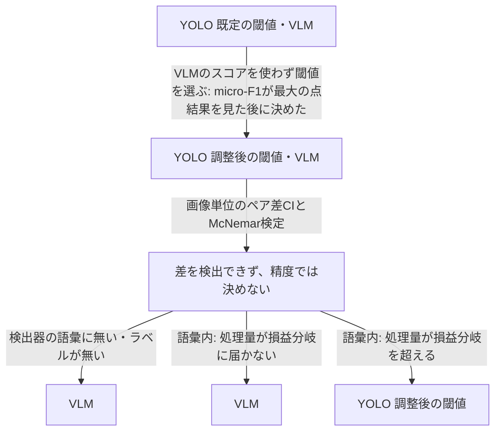
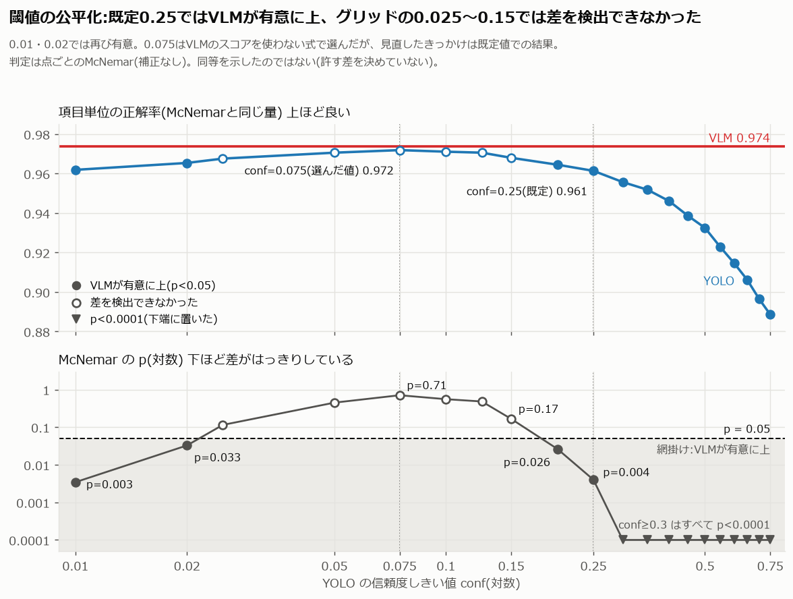
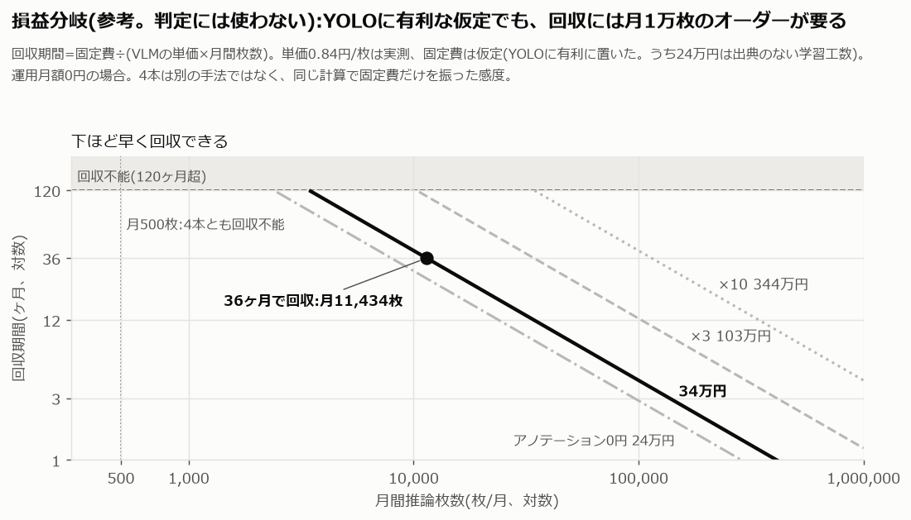

# vlm-vs-yolo ― COCOの有無判定でYOLOの閾値を調整するとVLMとの有意差が消え、選択はコスト・処理量・語彙で決まった

画像に「期待される項目」が写っているかを判定するタスクで、汎用の視覚言語モデル（VLM、Gemini Flash）と専用検出器（YOLO）を、COCO val2017の300枚で比べた。
問いは、既定の設定で出た有意差は実力の差か設定の差か、差が無いならどの条件でどちらを選ぶか、である。

記事: [前編（背景）](https://zenn.dev/yuya0408/articles/yolo-vs-vlm-background) / [後編（検証）](https://zenn.dev/yuya0408/articles/yolo-vs-vlm-evaluation-pitfall)　詳しい分析: [report/REPORT.md](report/REPORT.md)

> YOLOとVLMの優劣を決めるプロジェクトではない。許す差を決めていないので、同等は示していない。言えるのは「この件数では差を検出できなかった」までである。
> 閾値を見直すと決めたのは、既定値でVLMが有意に上回った結果を見た後である。結果より先に規則を決めたのは、プロンプトの確かめだけである。



---

## 結果サマリー

| 項目 | 値 |
| --- | --- |
| 評価セット | COCO val2017の300枚、2,281項目（各画像5〜10項目）。正解はアノテーションから機械的に決まる |
| 比べたもの | YOLO `yolo26x`（COCO学習済み、追加学習なし）と VLM `gemini-3.5-flash`（temperature 0） |
| 既定 conf=0.25 | VLM−YOLOの差：macro-F1 +5.5pt [+2.3, +7.8]、McNemar p=0.004。**VLMが有意に上** |
| 調整後 conf=0.075 | 差：macro-F1 +3.2pt [−0.4, +4.4]、micro-F1 +0.5pt [−0.7, +1.6]、McNemar p=0.71。**差を検出できなかった** |
| 有意でない閾値の範囲 | グリッド上のconf 0.025〜0.15。0.01・0.02と0.20以上では、VLMが有意に上（点ごとの検定で補正なし） |
| macro-F1の差の内訳 | 3.2ptのうち2.6ptは正例1件の2カテゴリ。正例3件以上に絞ると0.2pt |
| コスト（300枚） | YOLO 0円（API課金が0という意味）、VLM 251円 |
| レイテンシ中央値 | YOLO 0.33秒（手元のマシン）、VLM 5.42秒（API経由）。条件が違うので参考の約16倍 |
| 損益分岐 | YOLOに有利な仮定で累計約41万枚。回収36か月を許すなら月11,434枚 |
| プロンプト3水準 | ばらつきはmacro-F1で0.46pt。YOLOとの判定は変わらず（事前に決めた規則） |
| 語彙外のカテゴリ | 配管のチェックリスト10項目中9項目がCOCOの語彙に無く、YOLOは判定できない（定性デモ） |

| 用語 | 意味 |
| --- | --- |
| 有無判定 | 座標は問わず、カテゴリが画像に写っているかだけを判定する。YOLOは閾値以上の検出が1個でもあれば`present` |
| conf | YOLOの信頼度の閾値。既定は0.25 |
| macro-F1／micro-F1 | カテゴリごとのF1の平均（正例1件のカテゴリも同じ重み）／全カテゴリを足してから計算したF1 |
| item accuracy | 正解した項目の割合 |
| strict | VLMの`uncertain`を誤りとして数える集計。指標はすべてこれ |
| 差 [ ] | VLM−YOLOの点差と、画像単位のペア差ブートストラップ95%CI |

---

## 既定の閾値ではVLMが有意に上だったが、閾値を選び直すと差を検出できなくなった

**既定 conf=0.25 のp=0.004は、VLMのスコアを使わずに選んだ conf=0.075 でp=0.71になった。動かしたのはYOLOの閾値だけである。**



塗りの印はVLMが有意に上（点ごとのMcNemar p<0.05、多重比較の補正なし）、白抜きは差を検出できなかった点。下段の網掛けがp<0.05の側である。macro-F1とmicro-F1の差は次の表に載せた。

| conf | macro-F1の差 | micro-F1の差 | item accuracyの差 | YOLOだけ正解／VLMだけ正解 | McNemar p |
| --- | --- | --- | --- | --- | --- |
| 0.01 | +1.6pt | +1.9pt | +1.2pt | 26／53 | 0.003 |
| 0.02 | +4.0pt | +1.4pt | +0.8pt | 26／45 | 0.033 |
| 0.05 | +3.3pt | +0.7pt | +0.3pt | 28／35 | 0.45 |
| **0.075（選んだ点）** | +3.2pt | +0.5pt | +0.2pt | 30／34 | **0.71** |
| 0.10 | +3.5pt | +0.7pt | +0.3pt | 33／39 | 0.56 |
| 0.15 | +4.2pt | +1.2pt | +0.6pt | 31／44 | 0.17 |
| **0.25（既定）** | +5.5pt | +2.5pt | +1.2pt | 30／58 | **0.004** |

選定はmicro-F1とitem accuracyの最大で、どちらも0.075だった。300枚を120枚と180枚に分けて120枚で選んでも0.075で、残り180枚でもp=0.42である。
ただし3つの基準は同じ300枚から計算していて独立ではなく、分割も全体の集計を見た後に行った（[判定の規則](#判定の規則)）。

既定の閾値での差は、YOLOの見逃しから来ていた。誤答は88件から64件に減り、うち見逃しは77件から34件に減った（偽陽性は11件から30件に増えた）。
根拠は [REPORT §2](report/REPORT.md#2-しきい値の選定と堅牢性結論の前提ではなく確認)。

---

## macro-F1の差3.2ptの大半は、正例1件のカテゴリ2つから来ている

**conf=0.075で、toasterとtoothbrushだけで2.6ptを占め、正例3件以上の71カテゴリに絞ると差は0.2ptになる。**

| 絞り込み | カテゴリ数 | YOLO | VLM | 差 |
| --- | --- | --- | --- | --- |
| 正例1件以上（すべて） | 78 | 0.929 | 0.961 | +3.2pt |
| 正例3件以上 | 71 | 0.955 | 0.957 | +0.2pt |
| 正例6件以上 | 49 | 0.956 | 0.960 | +0.4pt |
| 正例11件以上 | 17 | 0.927 | 0.935 | +0.8pt |

macro-F1は正例1件のカテゴリも同じ重みなので、1件の正誤で1.28pt動く。CI [−0.4, +4.4]pt の中心が点差より小さいのも、同じカテゴリの影響である（[限界と範囲外](#限界と範囲外)）。
既定 conf=0.25 では同じ絞り込みでも +3.3pt 残るので、閾値による差は希少カテゴリだけの話ではない。
絞り込みは結果を見た後の確かめで、選定には使っていない。`results/comparison_tuned.json` の `support_sensitivity` にカテゴリ別の値がある。

---

## 精度で決められないので、決め手はコストとレイテンシに移る

**300枚のコストはYOLOが0円、VLMが251円で、レイテンシの中央値は0.33秒と5.42秒である。**

| | 300枚のコスト | レイテンシ中央値 | p95 | 条件 |
| --- | --- | --- | --- | --- |
| YOLO（conf=0.075） | 0円 | 0.33秒 | 0.52秒 | API課金が0という意味。手元のMacで計測 |
| VLM | 251円 | 5.42秒 | 7.87秒 | API経由。経路が違うので、同じ条件の比較ではない |

閾値は推論後のフィルタなので、調整してもコストとレイテンシは動かない。YOLOの学習や運用の費用は次の節で扱う。

---

## YOLOの固定費を回収できるのは、月1万枚のオーダーから

**YOLOに有利な仮定で固定費は34万円、損益分岐は累計約41万枚で、月500枚では固定費を上下に振っても回収できない。**



線の高さが、その月間枚数での回収期間である。網掛け（120か月超）は回収不能とみなす。

```
YOLOの累計(Tか月) = 固定費 + 運用の月額 × T
VLMの累計(Tか月)  = 0.84円/枚 × 月間枚数 × T          （251円 ÷ 300枚の実測）
固定費 = 3,000枚 × 5矩形 × 5.8円 × 手戻り1.2 + 40時間 × 6,000円 = 104,400円 + 240,000円 = 344,400円
```

| 固定費 | 損益分岐（累計） | 月500枚 | 月5,000枚 | 月50,000枚 | 月500,000枚 | 回収36か月に要る月の枚数 |
| --- | --- | --- | --- | --- | --- | --- |
| アノテーション0円（24万円） | 286,853枚 | 回収不能 | 57.4か月 | 5.7か月 | 0.6か月 | 7,968枚 |
| **基準（34万円）** | **411,633枚** | 回収不能 | 82.3か月 | 8.2か月 | 0.8か月 | **11,434枚** |
| ×3（103万円） | 1,234,900枚 | 回収不能 | 回収不能 | 24.7か月 | 2.5か月 | ― |
| ×10（344万円） | 4,116,335枚 | 回収不能 | 回収不能 | 82.3か月 | 8.2か月 | ― |

「月1万枚のオーダー」は、回収を36か月まで許す場合の目安である。この節は結果を見た後に足した分析で、値は仮定を置いて計算したものであり測っていない（[限界と範囲外](#限界と範囲外)）。
前提値と出典は [conf/costs.yaml](conf/costs.yaml) にある。

---

## プロンプトを3水準振っても、YOLOとの判定は変わらなかった

**実行の前に決めた規則で、tuneのmicro-F1が最大の水準は`concise`のままで、test（180枚）でのYOLOとの差は検出できなかった。**

| 水準 | 何を変えたか | macro-F1 | micro-F1 | item accuracy | uncertain率 | 差（test、macro-F1） | McNemar p（test） | コスト |
| --- | --- | --- | --- | --- | --- | --- | --- | --- |
| **`concise`（選ばれた）** | 基準 | 0.961 | 0.959 | 0.974 | 0.31% | +1.69pt [−2.33, +3.56] | 0.42 | 251円 |
| `deliberate`（参考） | 項目ごとの根拠を先に書かせる | 0.964 | 0.962 | 0.972 | 0.79% | +2.03pt [−1.96, +3.90] | 0.27 | 312円 |
| `calibrated`（参考） | 過剰な主張を抑え、`uncertain`の基準を明示 | 0.959 | 0.956 | 0.970 | 0.70% | +1.89pt [−2.12, +3.78] | 0.20 | 260円 |

| 事前に決めた規則（2026-08-31） | 結果（2026-09-05） |
| --- | --- |
| tuneのmicro-F1が最大の水準を選び、testでYOLOと比べる | `concise`を選び、p=0.42 で有意でない |
| ばらつきがYOLOの閾値の振れ幅（0.921〜0.945の2.4pt）と同程度以内なら「結論不変」 | macro-F1で0.46pt。満たす |
| VLMがtestで有意に上なら、結論を書き換える | 該当しない |

水準の数は3つで、プロンプトの空間を探索したわけではない。規則を決めた時点で`concise`の結果はすでに見ていて、`calibrated`はその誤りを見て作った。`deliberate`・`calibrated`の比較と3水準の全体検定（Friedman p=0.16）は、結果を見た後に足した。
根拠は [REPORT §2b](report/REPORT.md#2b-vlm-側のプロンプト感度3-水準実行済み結論不変)。

---

## 語彙外のカテゴリは、COCO学習済みのYOLOでは判定できない

**配管のチェックリスト10項目のうち9項目はCOCOの80クラスに無く、YOLOは閾値によらず`present`を返せない。VLMは追加の学習なしで判定と根拠を返す。**

| | 語彙内・ラベルあり（COCO） | 語彙外・ラベルなし（配管の5枚） |
| --- | --- | --- |
| YOLO | 閾値の調整で差を検出できなくなる | 10項目中9項目を判定できない |
| VLM | 差を検出できない | `present`／`absent`／`uncertain`と根拠を返す |
| 選択 | 処理量で分かれる（上の2節） | VLM |

正解ラベルが無いので、精度は測っていない。示したのは、動くかどうかだけである。ラベルを集めれば追加学習はできるが、その精度と費用は確かめていない。
画像ごとの判定は [REPORT 付録](report/REPORT.md#付録-建設ドメインでの適用可能性デモ定性)。

---

## 方法

### 共通の条件

| 条件 | 値 |
| --- | --- |
| タスク | 画像1枚とカテゴリのチェックリスト（5〜10項目）→ 各項目の有無 |
| データ | COCO val2017から300枚を、物体数と最小のbbox面積比で層化抽出（seed 42）。正例703項目。negativeには混同しやすいカテゴリ（dog↔catなど6組）を優先して入れる |
| 集計 | strict。正例のあるカテゴリ（78）で平均する |
| 区間 | 画像単位のブートストラップ（10,000回、percentile法）。同じリサンプルで差を計算する |
| 検定 | McNemar（項目単位、補助）。主な推論は画像単位のペア差CIである |
| tune／test | 同じ分割（seed 42、120枚と180枚）を閾値とプロンプトの両方に使う |

### 対象ごとの条件

| 条件 | YOLO | VLM |
| --- | --- | --- |
| モデル | `yolo26x.pt`（Ultralytics、COCO学習済み） | `gemini-3.5-flash`、temperature 0 |
| 出力の扱い | 閾値以上の検出が1個でもあれば`present`、なければ`absent`。座標は使わない | `present`／`absent`／`uncertain` |
| 調整したもの | conf。0.001で1回推論し、後処理で全点を走査（1点あたり無料） | プロンプト3水準。1水準あたりN=300の再推論（全走査はできない） |
| 実行 | 手元のマシン | Gemini API。レスポンスをキャッシュ |
| コストの数え方 | API課金のみ（0円）。固定費は損益分岐で別に扱う | 実際のトークン数 × 2026-06-23の単価 |

### 判定の規則

| 判定 | 規則 | なぜその規則か | 決めた時点 |
| --- | --- | --- | --- |
| 比較の土俵 | 画像レベルの有無に揃える | 座標で比べるとVLMが構造的に不利で、タスクに座標は要らない | 実行の前 |
| 閾値の見直し | 既定の0.25に加えて全点を走査する | 片方だけ既定値のまま比べていたため | **既定値の結果を見た後** |
| 操作点 | micro-F1とitem accuracyが最大の閾値。VLMのスコアは使わない | 検出器のF1最大点を使う慣行。macro-F1最大の0.01は偽陽性が増える点なので使わない | **結果を見た後** |
| 確かめる範囲 | conf 0.01〜0.10 の点差を見る | 操作点の周辺で判断が変わらないかを見るため | **結果を見た後** |
| モデル間の差 | ペア差CIとMcNemarがどちらも差を示さなければ「検出できなかった」。許す差は置かない | 同等を言うには許す差が要るが、決めていなかった | McNemarは実行の前、**ペア差CIを主な推論にしたのは結果を見た後**（2026-08-29） |
| プロンプト | 上の節の表のとおり | YOLOの閾値選びと同じ手順にそろえるため | **実行の前**（2026-08-31のコミット`c2a2192`、実行は2026-09-05） |
| 損益分岐 | YOLOに有利な値を置き、固定費を上下に振る | 固定費は環境によるので、点の推定にしない | **結果を見た後** |

コミットの履歴は最初の推論（2026-06）の後の2026-07-19に始まるので、それより前の「実行の前」は履歴からは確かめられない。履歴で確かめられる事前の決定はプロンプトの規則だけである。

---

## 限界と範囲外

| 項目 | 何が言えないか | 結論への影響 | 根拠 |
| --- | --- | --- | --- |
| 事後の選定 | 閾値は既定値の結果を見た後に選び直した。選定の式はVLMを使わないが、同じ300枚で選んで報告している | 閾値の効果は別のデータで確かめていない。分割の180枚でも選定前に全体の集計を見ている | [判定の規則](#判定の規則) |
| 同等 | 許す差を決めていない。macro-F1のCIの上端は+4.4pt | 「差を検出できなかった」まで | [REPORT §6](report/REPORT.md#6-限界脅威) |
| 検出力 | testは180枚。有意でないことは差が無いことを示さない | 小さな差は見つけられない | [REPORT §6](report/REPORT.md#6-限界脅威) |
| macro-F1のCI | リサンプルで正例1件の画像が抜けると、平均するカテゴリの集合が変わる。差のCIは点差の周りに対称にならず、下に寄る | 差はmicro-F1・item accuracyと合わせて読む | [REPORT §6](report/REPORT.md#6-限界脅威) |
| 閾値の端 | conf 0.01・0.02ではVLMが再び有意 | 「閾値によらず有意でない」とは言えない。点差は数ptに収まる | [詳しい値](#閾値の全点) |
| レイテンシ | YOLOは手元のMacで、機種とデバイスの記録が無い。VLMはAPI経由で、ネットワークと時間帯による単発の計測 | 約16倍は参考の値。GPUの有無で変わる | ― |
| 損益分岐の仮定 | 手戻り1.2、40時間、6,000円/時、1枚5矩形は出典の無い仮定。3,000枚で目標の精度に届くかも確かめていない | 固定費の7割は学習工数の仮定で、「下限」ではない。自分の値で計算し直す前提 | [conf/costs.yaml](conf/costs.yaml) |
| VLM | 1プロバイダ・1モデル、プロンプト3水準、temperature 0 | ほかのVLMやプロンプトでは変わり得る | [REPORT §2b](report/REPORT.md#2b-vlm-側のプロンプト感度3-水準実行済み結論不変) |
| 語彙 | COCO 80クラスの中はYOLOの学習範囲で、YOLOに最も有利な条件 | 語彙内の結論は語彙外に当てはまらない | [REPORT §7](report/REPORT.md#7-意思決定ルールまとめ-二象限) |
| 追加学習 | YOLOのファインチューニングはしていない（COCOで評価するので汚染になる） | 語彙外で追加学習した場合の精度は分からない | [REPORT §6](report/REPORT.md#6-限界脅威) |
| 座標 | bboxとIoUは測っていない | 座標が要るタスクには当てはまらない | [docs/DESIGN.md](docs/DESIGN.md) |
| 語彙外のデモ | 5枚・正解ラベルなし | 精度の主張はしない | [REPORT 付録](report/REPORT.md#付録-建設ドメインでの適用可能性デモ定性) |
| 回帰ゲート | PRで回るのはmockでの評価（n=50）だけで、本物のモデルの精度は見ていない | パイプラインの破損を検出するもの | [eval-pr.yaml](.github/workflows/eval-pr.yaml) |

設計の段階で考えて実行しなかった分析は [docs/DESIGN.md §4](docs/DESIGN.md#4-統計的評価) に書いてある。

---

## 詳しい値

### 調整後 conf=0.075 と VLM

| 指標 | YOLO | VLM | 差 [95%CI] |
| --- | --- | --- | --- |
| macro-F1 | 0.929 | 0.961 | +3.2pt [−0.4, +4.4] |
| micro-F1 | 0.954 | 0.959 | +0.5pt [−0.7, +1.6] |
| item accuracy | 0.972 | 0.974 | +0.2pt [−0.5, +0.9] |
| 個数recall（副軸） | 0.927 | 0.871 | ― |
| uncertain率 | 0% | 0.31%（7/2,281） | ― |

test 180枚では、差はmacro-F1 +1.69pt [−2.33, +3.56]、micro-F1 −0.47pt [−1.83, +0.86]、item accuracy −0.43pt [−1.29, +0.42] で、micro-F1とitem accuracyはYOLOが上である（どちらも差は検出できない）。

### 閾値の全点

| conf | macro-F1 | micro-F1 | item accuracy | 個数recall | McNemar p |
| --- | --- | --- | --- | --- | --- |
| 0.01 | 0.945 | 0.941 | 0.962 | 0.985 | 0.003 |
| 0.02 | 0.921 | 0.945 | 0.965 | 0.971 | 0.033 |
| 0.025 | 0.926 | 0.948 | 0.968 | 0.970 | 0.11 |
| 0.05 | 0.929 | 0.953 | 0.971 | 0.951 | 0.45 |
| **0.075** | 0.929 | **0.954** | **0.972** | 0.927 | 0.71 |
| 0.10 | 0.926 | 0.953 | 0.971 | 0.907 | 0.56 |
| 0.125 | 0.926 | 0.951 | 0.971 | 0.887 | 0.48 |
| 0.15 | 0.920 | 0.947 | 0.968 | 0.868 | 0.17 |
| 0.20 | 0.914 | 0.940 | 0.965 | 0.822 | 0.026 |
| 0.25 | 0.906 | 0.934 | 0.961 | 0.767 | 0.004 |

0.30以上は [results/yolo_threshold.json](results/yolo_threshold.json) にあり、macro-F1は下がり続ける。グリッドの刻みは荒く、より細かく見るとmicro-F1の最大は0.08付近にずれる（0.956）が、0.075との差は0.2ptである。

### 誤りの内訳（調整後 conf=0.075）

| 種類 | YOLO | VLM |
| --- | --- | --- |
| 見逃し | 34 | 28 |
| 混同しやすいカテゴリの偽陽性 | 17 | 11 |
| その他の偽陽性 | 13 | 14 |
| `uncertain`（正例・負例） | 0・0 | 4・3 |
| 計 | 64 | 60 |

誤りの要因のロジスティック回帰（画像単位のクラスタ頑健SE）では、正例の項目で誤りやすいのは両方とも同じで（オッズ比 YOLO 2.43、VLM 2.25、ともにp=0.001）、小さい物体で誤りやすい傾向はVLMだけ有意だった（p=0.03。YOLOはp=0.20）。

---

## 実行環境と費用

| 項目 | 値 |
| --- | --- |
| YOLO | `yolo26x.pt`（sha256 `9fdd44a3…`）。実行は2026-06-23、手元のMac。Ultralyticsの版、機種、デバイスは記録なし |
| VLM | `gemini-3.5-flash`。実行は2026-06-29（`concise`）、2026-09-05（`deliberate`・`calibrated`） |
| 評価セット | [data/eval_set.json](data/eval_set.json)（sha256 `289d6c0e…`） |
| 単価 | 入力$1.50・出力$9.00／100万トークン、1ドル161.5円（2026-06-23、[conf/pricing.yaml](conf/pricing.yaml)） |

| 実行 | 費用 |
| --- | --- |
| `concise` 300枚 | 251円 |
| `deliberate` 300枚 | 312円 |
| `calibrated` 300枚 | 260円 |
| 計（語彙外のデモ5枚は記録なし） | 823円 |

`concise`は2026-09-05にもキャッシュから読み直していて、応答は初回と同じである。

---

## 動かし方

cloneしたそのまま（APIキー、COCO画像、YOLOの重みは不要）：

```bash
pip install -r requirements.txt
python -m pytest -q
python -m src.runner --eval-set data/eval_set_smoke.json --model mock --results-dir ci_results
python -m src.gate regression --current ci_results/mock-mock-66143781.json --baseline baselines/mock_smoke_baseline.json
```

```
=== regression gate (macro_f1 strict) ===
baseline macro_f1 = 0.4097
current  macro_f1 = 0.4097
drop = +0.0000  (許容 0.0200)
McNemar: n01(cur正/base誤)=0 n10(cur誤/base正)=0 p=1.0000  ※参考
結果: PASS
```

コミットしてある `results/` から、数値と図を作り直す（無料。Windowsでは `PYTHONUTF8=1` を付ける。図は日本語フォントMeiryoを使う）：

```bash
python -m src.analysis.yolo_threshold sweep --raw results/yolo_raw_detections.json --eval-set data/eval_set.json
python -m src.analysis.compare --yolo results/yolo-yolo26x-tuned075-289d6c0e.json \
    --vlm results/gemini-gemini-3.5-flash-289d6c0e.json --eval-set data/eval_set.json --out results/comparison_tuned.json
python -m src.analysis.breakeven          # 前提は conf/costs.yaml を書き換える
python -m src.analysis.plots
python -m src.analysis.breakeven --figure report/figures/breakeven_ja.png
```

推論からやり直す場合（COCO val2017、`yolo26x.pt`、`.env`の`GEMINI_API_KEY`が要り、VLMは1水準あたり約250〜310円）：

```bash
python -m src.analysis.yolo_threshold capture --eval-set data/eval_set.json --weights yolo26x.pt
python -m src.runner --eval-set data/eval_set.json --model flash
```

プロンプトの比較のコマンドは [REPORT §2b](report/REPORT.md#2b-vlm-側のプロンプト感度3-水準実行済み結論不変) にある。

## ディレクトリ構成

| 場所 | 中身 |
| --- | --- |
| `src/providers/` | モデルの呼び出し（`mock`・`yolo`・`gemini`） |
| `src/runner.py` | 評価セットを回して `results/{run_id}.json` に保存する。VLMの応答は `cache/` に置く |
| `src/gate.py` | 回帰ゲートとコストの確認 |
| `src/analysis/` | 閾値の走査（`yolo_threshold.py`）、比較（`compare.py`）、誤りの内訳（`error_taxonomy.py`）、プロンプト（`prompt_sensitivity.py`）、損益分岐（`breakeven.py`）、語彙外のデモ（`construction_demo.py`） |
| `src/analysis/plots.py`・`breakeven.py` | READMEの図を作る（`report/figures/`）。色はYOLO＝青、VLM＝赤 |
| `conf/` | モデル、プロンプト、単価、損益分岐の前提、ゲートのしきい値 |
| `data/` | 評価セットとsmoke（COCOの画像は含まない）、語彙外のデモの画像（`construction/`） |
| `results/` | 各ランの判定と集計。READMEの数値はすべてここから出る |
| `baselines/` | 回帰ゲートの基準（mock） |
| `report/REPORT.md` | 詳しい分析 |
| `docs/` | 設計（`DESIGN.md`）、関連研究のメモ（`RELATED_WORK.md`） |

## データ・ライセンス・出典

- コード: [MITライセンス](LICENSE)。
- COCO val2017: アノテーションはCC BY 4.0、画像はFlickrの各ライセンス（[cocodataset.org](https://cocodataset.org/#termsofuse)）。`data/eval_set.json`はアノテーションから作り、画像は含まない。
- YOLO: [Ultralytics](https://github.com/ultralytics/ultralytics)。ライブラリと重みはAGPL-3.0で、重みはこのリポジトリに含まない。
- 語彙外のデモの画像: Wikimedia Commons。作者とライセンス（CC BY 2.0、CC BY-SA 3.0・4.0、CC0）は画像ごとに [data/construction/attributions.json](data/construction/attributions.json) にある。MITライセンスの対象外である。
- 損益分岐の前提の出典（2026-08-31取得）: [SageMaker Ground Truth](https://aws.amazon.com/sagemaker-ai/groundtruth/pricing/)、[Ultralytics](https://docs.ultralytics.com/yolov5/tutorials/tips-for-best-training-results)、[Papadopoulos et al. 2016](https://arxiv.org/abs/1602.08405)。
